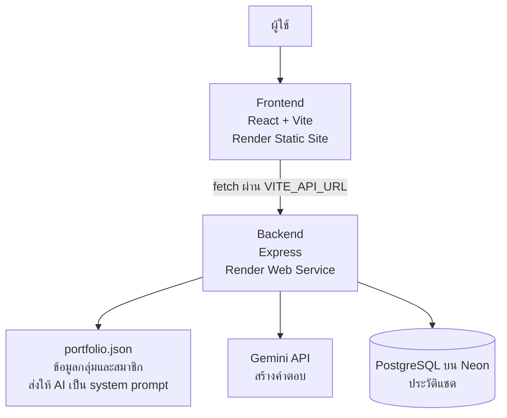
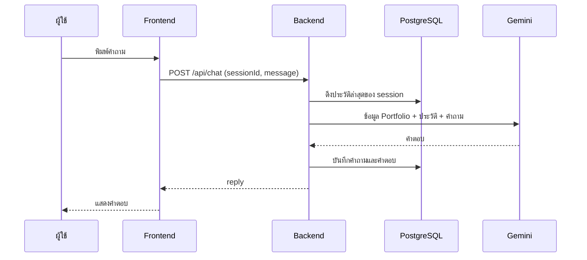
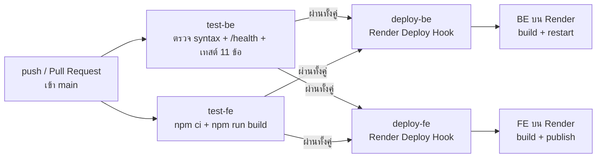

# AIE312-404-Brain-not-found

AI-powered detective-themed team portfolio website built with React, Express.js, PostgreSQL, and Gemini API. AIE312 Final Project.

### เกี่ยวกับโปรเจกต์ (404 Brain Not Found · Chat AI Portfolio)

เว็บแอป Portfolio ของกลุ่ม 404 Brain Not Found (Detective Development Team) ในธีมแฟ้มคดีนักสืบ ผู้เยี่ยมชมดูข้อมูลทีมและสมาชิกแต่ละคน หรือพูดคุยกับ Detective AI ที่ตอบจากข้อมูล Portfolio จริงของสมาชิกทุกคน

## Live demo

| ส่วน | ลิงค์ |
| --- | --- |
| เว็บไซต์ (Frontend) | https://aie312-404-brain-not-found-fe.onrender.com |
| Backend API | https://aie312-404-brain-not-found-be.onrender.com |
| ตรวจสถานะ BE | https://aie312-404-brain-not-found-be.onrender.com/health |

> Render แบบ Free จะหลับเมื่อไม่มีคนใช้งาน การเปิดครั้งแรกอาจรอ 30-60 วินาที ถ้าหน้าแชตค้างตอนแรกให้รอแล้วลองใหม่

## สมาชิก

| ชื่อ-นามสกุล | บทบาท | ความรับผิดชอบ | GitHub |
| --- | --- | --- | --- |
| Teernai Teeraparpvongsa (Tonn) | Backend Developer | Express API, ฐานข้อมูล PostgreSQL บน Neon, เชื่อม Gemini และเขียน system prompt, CI/CD, deploy | teeranai-teer |
| Suppakorn Sangjan (Peem) | Frontend Developer | ออกแบบและพัฒนาหน้าเว็บด้วย React, ห้องแชต, รองรับมือถือ, เชื่อมกับ Backend | Peem040 |

## ฟีเจอร์

- Portfolio: หน้าแรก, ทีมและสมาชิก, หน้าโปรไฟล์รายคน (ประวัติ ทักษะ ผลงาน ช่องทางติดต่อ), โปรเจกต์ทั้งหมด, ติดต่อ
- Chat AI (Interrogation Room): ถามเรื่องกลุ่มและสมาชิก AI ตอบจากข้อมูลใน portfolio.json เท่านั้น ถ้าไม่มีข้อมูลจะบอกตรงๆ ไม่แต่งเรื่อง และจำบริบทการสนทนาล่าสุด
- ประวัติแชต: เก็บในฐานข้อมูล PostgreSQL ผูกกับ sessionId ของแต่ละเบราว์เซอร์ รีเฟรชแล้วประวัติยังอยู่
- ตั้งค่า: สลับธีม 3 แบบ และสลับภาษาไทย/อังกฤษ
- รองรับมือถือ
- CI/CD: push เข้า main แล้วระบบทดสอบและ deploy ให้อัตโนมัติ

## Tech Stack

| ส่วน | เทคโนโลยี/เครื่องมือที่ใช้ |
| --- | --- |
| Frontend | React, Vite, React Router |
| Backend | Node.js, Express |
| Database | PostgreSQL บน Neon |
| AI | Google Gemini API (@google/genai) โมเดลตั้งผ่าน GEMINI_MODEL |
| CI/CD | GitHub Actions |
| Hosting | Render (Web Service สำหรับ BE, Static Site สำหรับ FE) |

## สถาปัตยกรรม



ลำดับการทำงานของแชต: FE ส่ง { sessionId, message } ไป POST /api/chat → BE ดึงประวัติล่าสุดของ session จาก DB → ส่งข้อมูล Portfolio + ประวัติ + คำถามให้ Gemini → บันทึกคำถามและคำตอบลง DB → ส่ง { reply } กลับ



## โครงสร้างโปรเจกต์
.
├─ BE/
│  ├─ index.js         # Express server, API, เรียก Gemini
│  ├─ db.js            # การเชื่อมต่อ PostgreSQL
│  ├─ portfolio.json   # ข้อมูลกลุ่มและสมาชิก (แหล่งข้อมูลของ AI และของหน้าเว็บ)
│  ├─ api.test.js      # เทสต์ endpoint
│  ├─ server.test.js   # เทสต์พฤติกรรมของ server
│  ├─ .env.example
│  └─ package.json
├─ FE/
│  ├─ src/             # โค้ด React (pages, components, api.js, portfolio.jsx ฯลฯ)
│  ├─ public/members/  # รูปสมาชิก
│  ├─ .env.example
│  └─ package.json
├─ .github/workflows/
│  └─ ci-cd.yml        # pipeline CI/CD
└─ README.md

## เริ่มต้นใช้งาน (รันในเครื่อง)

### สิ่งที่ต้องมี

- Node.js 20 ขึ้นไป (pipeline ใช้ Node 22)
- ฐานข้อมูล PostgreSQL (ใช้ connection string ของ Neon ได้)
- Gemini API key จาก https://aistudio.google.com

## 1) Backend

```bash
git clone https://github.com/teeranai-teer/AIE312-404-Brain-not-found.git
cd AIE312-404-Brain-not-found/BE

# สร้างไฟล์ env จากตัวอย่าง แล้วแทนค่าตัวอย่างด้วยค่าจริง
cp .env.example .env

npm install
npm start
```
BE รันที่ http://localhost:3000 ลองตรวจ:
```bash
curl http://localhost:3000/health
```

ตารางในฐานข้อมูล (conversations, messages) ต้องมีอยู่ก่อนเริ่มใช้แชต ดู SQL สร้างตารางด้านล่าง

## 2) Frontend
```bash
    cd FE
    cp .env.example .env      # แล้วตั้ง VITE_API_URL
    npm install
    npm run dev
```

เปิด http://localhost:5173
- ถ้า ไม่ตั้ง VITE_API_URL FE จะใช้ข้อมูลจำลอง (mock) ไม่เรียก BE
- ชี้ไป BE ในเครื่อง: VITE_API_URL=http://localhost:3000 (และตั้ง FRONTEND_URL= http://localhost:5173 ใน BE/.env)
- ชี้ไป BE บน Render: VITE_API_URL= https://aie312-404-brain-not-found-be.onrender.com

ค่า VITE_ ถูกฝังตอน build/เริ่ม dev server ถ้าแก้ .env ต้องรีสตาร์ท

## Environment Variables

### Backend (BE/.env หรือหน้า Environment ของ service บน Render)

| ตัวแปร | คำอธิบาย |
| --- | --- |
| DATABASE_URL | connection string ของ PostgreSQL ขึ้นต้นด้วย postgresql:// |
| GEMINI_API_KEY | API key ของ Gemini |
| GEMINI_MODEL | ชื่อโมเดล Gemini ที่ใช้ (ถ้าเจอ error 404 ให้ตรวจชื่อโมเดลล่าสุด) |
| FRONTEND_URL | ที่อยู่เว็บ FE สำหรับ CORS ไม่มี / ท้าย ถ้าไม่ตั้ง BE จะยอมทุกเว็บ |
| PORT | พอร์ตของ BE (ค่าเริ่มต้น 3000, Render กำหนดให้เอง) |

### Frontend (FE/.env หรือ Environment ของ Static Site บน Render)

| ตัวแปร | คำอธิบาย |
| --- | --- |
| VITE_API_URL | URL ของ BE ไม่มี / ท้าย (https://aie312-404-brain-not-found-be.onrender.com) |

ไฟล์ตัวอย่างอยู่ที่ BE/.env.example และ FE/.env.example ห้าม commit ไฟล์ .env จริง (อยู่ใน .gitignore แล้ว)

## ฐานข้อมูล
ใช้ PostgreSQL 2 ตาราง:

```sql
CREATE TABLE conversations (
  id SERIAL PRIMARY KEY,
  session_id TEXT NOT NULL,
  created_at TIMESTAMPTZ DEFAULT NOW()
);

CREATE TABLE messages (
  id SERIAL PRIMARY KEY,
  conversation_id INTEGER REFERENCES conversations(id),
  role TEXT NOT NULL,          -- 'user' หรือ 'model'
  content TEXT NOT NULL,
  created_at TIMESTAMPTZ DEFAULT NOW()
);
```

> โครงสร้างข้างบนเขียนตามคอลัมน์ที่ใช้งานจริง ถ้า schema ใน Neon ของคุณต่างจากนี้ (ชนิดข้อมูลหรือ constraint) ให้แก้ให้ตรงของจริงก่อนส่ง

## API

| Method | Path | คำอธิบาย |
| --- | --- | --- |
| GET | /health | ตรวจสถานะ ตอบ { "status": "ok" } |
| GET | /api/portfolio | ข้อมูลกลุ่มและสมาชิก { group, members } |
| POST | /api/chat | ส่งข้อความให้ AI ตอบ |
| GET | /api/history/:sessionId | ประวัติแชตของ session |

## POST /api/chat

**Request**

```json
{ "sessionId": "abc-123", "message": "Peem ทำอะไรในทีม" }
```

**Response 200**

```json
{ "reply": "ข้อความคำตอบจาก AI" }
```
ข้อผิดพลาดตอบเป็น { "error": "ข้อความภาษาไทย" } เช่น 400 เมื่อไม่มี message หรือ sessionId
GET /api/history/:sessionId ตอบ { "messages": [{ "role": "user", "content": "..." }] }

## AI ตอบจากข้อมูลอะไร

BE อ่าน BE/portfolio.json แล้วส่งให้ Gemini เป็น system prompt พร้อมกำหนดบทบาท Detective AI ให้ตอบจากข้อมูลนี้เท่านั้น คำถามนอกขอบเขตหรือไม่มีข้อมูลจะได้คำตอบว่าไม่มีหลักฐาน ข้อมูลเดียวกันนี้ถูกใช้แสดงในหน้า Team, โปรไฟล์ และ Projects ของเว็บด้วย ถ้าต้องการแก้ข้อมูลสมาชิกหรือผลงาน แก้ที่ portfolio.json ที่เดียว

## Testing

``` bash 
cd BE
npm install
node --check index.js              # ตรวจ syntax
node --test api.test.js server.test.js
```
เทสต์ 11 ข้อ (api.test.js 4 ข้อ, server.test.js 7 ข้อ) ไม่ต้องใช้ฐานข้อมูลหรือ API key จริง ครอบคลุม /health, /api/portfolio, กรณีส่งข้อมูลไม่ครบ, JSON ที่พัง, ข้อความว่างหรือยาวเกิน, เส้นทางที่ไม่มี และ CORS

> ส่วนที่ต้องใช้ Gemini และฐานข้อมูลจริง (แชตสำเร็จ, บันทึกและดึงประวัติ) ทดสอบด้วยมือบนเว็บจริง

ฝั่ง FE ตรวจด้วย build:
``` bash 
    cd FE
    npm install
    npm run build
```
## CI/CD

ใช้ GitHub Actions ไฟล์ .github/workflows/ci-cd.yml ทำงานทุกครั้งที่ push และทุก Pull Request เข้า main


deploy-be และ deploy-fe ทำงานเฉพาะตอน push เข้า main ส่วน Pull Request จะรันแค่ test-be กับ test-fe

| Job | ทำอะไร | ทำงานเมื่อ |
| --- | --- | --- |
| test-be | ตรวจ syntax, สตาร์ท server ยิง /health, รันเทสต์ | ทุก push และ PR |
| test-fe | ติดตั้งและ npm run build | ทุก push และ PR |
| deploy-be | เรียก Deploy Hook ให้ Render deploy BE | push เข้า main และ test ผ่านทั้งสองฝั่ง |
| deploy-fe | เรียก Deploy Hook ให้ Render deploy FE | push เข้า main และ test ผ่านทั้งสองฝั่ง |

ถ้า test ตัวใดไม่ผ่าน job deploy จะไม่ทำงาน โค้ดที่มีปัญหาจึงไม่ถูกนำขึ้นเว็บจริง

## GitHub Secrets (Settings → Secrets and variables → Actions)

| ชื่อ | ค่า |
| --- | --- |
| RENDER_DEPLOY_HOOK_BE | Deploy Hook URL ของ BE บน Render |
| RENDER_DEPLOY_HOOK_FE | Deploy Hook URL ของ FE บน Render |

ค่า DATABASE_URL และ GEMINI_API_KEY ไม่อยู่ใน pipeline ตั้งไว้ที่หน้า Environment ของ service บน Render

## Deployment (Render)
### Backend: Web Service

| ช่อง | ค่า |
| --- | --- |
| Source | Public Git Repository (repo นี้, branch main) |
| Root Directory | BE |
| Build Command | npm install |
| Start Command | npm start |
| Environment | DATABASE_URL, GEMINI_API_KEY, GEMINI_MODEL, NODE_VERSION=22 |

### Frontend: Static Site

| ช่อง | ค่า |
| --- | --- |
| Root Directory | FE |
| Build Command | npm install && npm run build |
| Publish Directory | dist |
| Environment | VITE_API_URL = URL ของ BE |
| Redirects/Rewrites | /* → /index.html (Action: Rewrite) เพื่อให้รีเฟรชหน้าย่อยได้ |

จากนั้นคัดลอก Deploy Hook ของทั้งสอง service (Settings → Deploy Hook) ไปตั้งใน GitHub Secrets ต่อจากนี้ทุกครั้งที่ push เข้า main เว็บจะอัปเดตเอง

## Troubleshooting

| ชื่อ error หรืออาการ | สาเหตุที่พบบ่อย | วิธีแก้ |
|---|---|---|
| เปิดเว็บแล้วรอนานหรือขึ้น "โหลดข้อมูลไม่สำเร็จ" | BE แบบ Free กำลังหลับ | รอ 30-60 วินาทีแล้วกดลองใหม่ |
| แชตตอบ error | `GEMINI_API_KEY` ผิด ชื่อโมเดลไม่ถูกต้อง หรือโควตาเต็ม | ดู Logs ของ BE แล้วตรวจค่าใน Environment |
| รีเฟรชหน้า `/chat` แล้ว 404 | ยังไม่ได้ตั้ง Rewrite ของ Static Site | เพิ่มกฎ `/*` → `/index.html` |
| FE ในเครื่องเรียก BE ไม่ได้ (CORS) | `FRONTEND_URL` ใน BE ไม่ตรงกับที่อยู่ FE | ตั้งให้ตรง ไม่มี `/` ท้าย หรือลบตัวแปรนี้ |
| รูปสมาชิกไม่ขึ้น | ชื่อไฟล์ใน `FE/public/members/` ไม่ตรงกับ `photo` ใน `portfolio.json` | ตรวจตัวพิมพ์เล็กใหญ่และนามสกุล (Render รันบน Linux) |
| `npm run build` ในเครื่องหา `package.json` ไม่เจอ | รันที่รากของ repo | `cd FE` หรือ `cd BE` ก่อน |

## สิ่งที่ยังไม่ได้ทำ

- Docker, Docker Hub และการสแกนช่องโหว่ด้วย Trivy (ไม่อยู่ในข้อกำหนดของโจทย์)
- จำกัดจำนวนการเรียก /api/chat (rate limit)