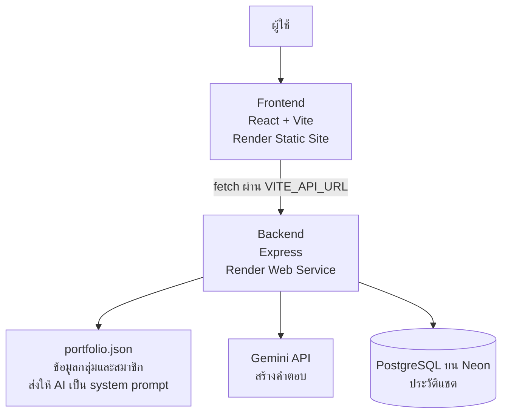
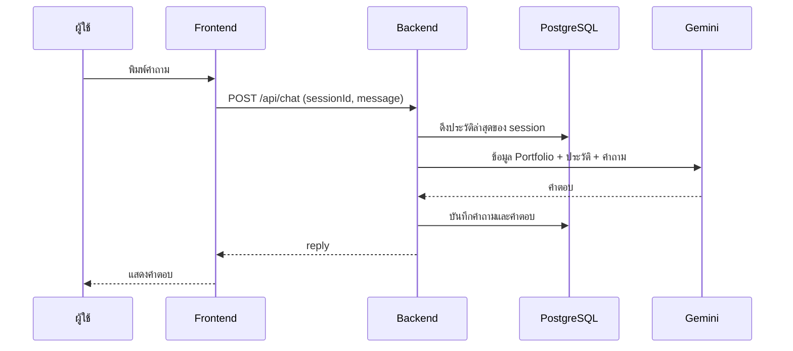
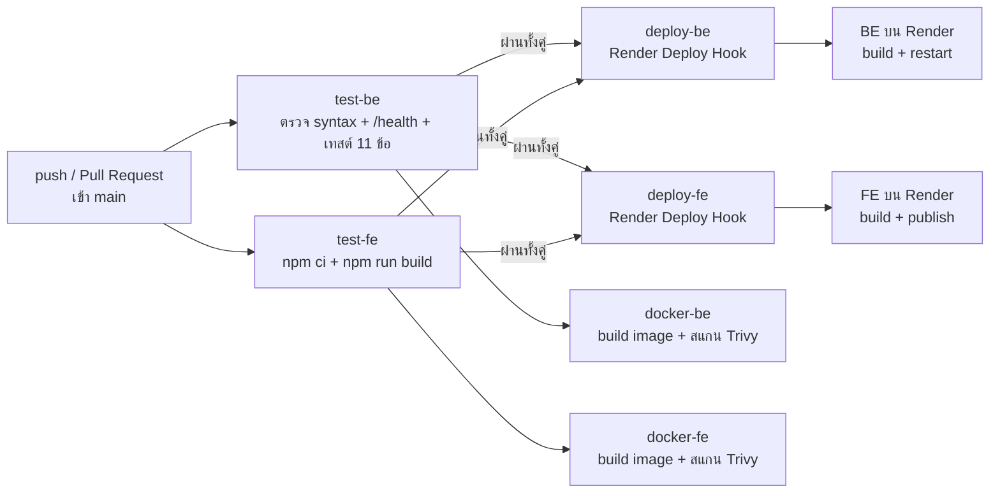

# AIE312-404-Brain-not-found

AI-powered detective-themed team portfolio website built with React, Express.js, PostgreSQL, and Gemini API. AIE312 Final Project.

## เกี่ยวกับโปรเจกต์ (404 Brain Not Found · Chat AI Portfolio)

เว็บแอป Portfolio ของกลุ่ม 404 Brain Not Found (Detective Development Team) เป็นหน้าเดียวแบบ interactive ในธีมสำนักงานนักสืบยุควิกตอเรีย ผู้เยี่ยมชมเดินเรื่องผ่านฉากวิดีโอ (เมือง → ประตู → ห้องนักสืบ) แล้วเลือกได้ว่าจะคุยกับ Detective AI ที่ตอบจากข้อมูล Portfolio จริงของสมาชิก ดูแฟ้มประวัติของสมาชิกแต่ละคน หรือดูใบประกาศจับ

ข้อมูลสมาชิกในแฟ้มประวัติและคำตอบของ AI มาจาก `BE/portfolio.json` แหล่งเดียว ผ่าน API ของ Backend

## Live demo

| ส่วน | ลิงก์ |
| --- | --- |
| เว็บไซต์ (Frontend) | https://aie312-404-brain-not-found-fe.onrender.com |
| Backend API | https://aie312-404-brain-not-found-be.onrender.com |
| ตรวจสถานะ BE | https://aie312-404-brain-not-found-be.onrender.com/health |

> Render แบบ Free จะหลับเมื่อไม่มีคนใช้งาน การเปิดครั้งแรกอาจรอ 30-60 วินาที ถ้าหน้าแชตค้างตอนแรกให้รอแล้วลองใหม่

## สมาชิก

| ชื่อ-นามสกุล | บทบาท | ความรับผิดชอบ | GitHub |
| --- | --- | --- | --- |
| Teeranai Teeraparpvongsa (Tonn) | Backend Developer | Express API, ฐานข้อมูล PostgreSQL บน Neon, เชื่อม Gemini และเขียน system prompt, CI/CD, deploy | [teeranai-teer](https://github.com/teeranai-teer) |
| Suppakorn Sangjan (Peem) | Frontend Developer | Frontend: วางโครงแอป React + Vite, ชั้นเรียก API (`api.js`), การเก็บห้องแชต (`sessions.js`), การแสดงคำตอบ AI แบบ Markdown (`RichText.jsx`), ข้อมูลจำลอง (`mockApi.js`) และหน้าเว็บรุ่นแรกแบบหลายหน้า | [Peem040](https://github.com/Peem040) |

### งานของ Teeranai (Tonn): Backend, Database, AI, CI/CD

| งาน | รายละเอียด |
| --- | --- |
| Backend API | สร้าง Express server และ endpoint `/health`, `/api/portfolio`, `/api/chat`, `/api/history/:sessionId` (ดึงและลบประวัติแชต) ตรวจข้อมูลที่ส่งเข้ามา (ไม่มีข้อความ ข้อความว่าง ข้อความยาวเกิน 1,000 ตัวอักษร ไม่มี `sessionId`) และตอบ error เป็นภาษาไทย |
| ฐานข้อมูล | ออกแบบตาราง `conversations` และ `messages` บน PostgreSQL (Neon) เก็บประวัติแชตแยกตาม session เชื่อมต่อผ่าน `db.js` |
| AI | เชื่อม Gemini API เขียน system prompt ให้ Detective AI ตอบจากข้อมูลใน `portfolio.json` เท่านั้น ไม่แต่งเรื่อง ส่งประวัติแชตล่าสุดเพื่อให้จำบริบท ตอบตามภาษาของผู้ใช้ ใช้ชื่อเต็มพร้อมชื่อเล่น และจัดการกรณี Gemini ไม่ว่างหรือผิดพลาด |
| ข้อมูล Portfolio | จัดทำ `portfolio.json` (ข้อมูลกลุ่ม สมาชิก ผลงาน) ซึ่งเป็นแหล่งข้อมูลเดียวของทั้ง AI และหน้าเว็บ |
| เทสต์ | เขียนเทสต์อัตโนมัติ 11 ข้อ (`api.test.js`, `server.test.js`) ที่ไม่ต้องใช้ฐานข้อมูลหรือ API key |
| CI/CD | ตั้ง GitHub Actions: ทดสอบ BE และ FE แล้ว deploy ขึ้น Render อัตโนมัติผ่าน Deploy Hook |
| Deploy | ตั้งค่า Render (BE เป็น Web Service, FE เป็น Static Site พร้อม Rewrite) และฐานข้อมูลบน Neon |
| เชื่อม FE กับ BE | แก้จุดต่อข้อมูลระหว่างสองฝั่ง (`FE/src/portfolio.jsx` แปลงรูปแบบข้อมูลจาก BE) เพิ่มรูปสมาชิก |
| หน้าสำนักงานนักสืบ | พัฒนาหน้าเว็บใหม่หน้าเดียวเป็น React (`FE/src/story/`): ระบบเปลี่ยนฉากวิดีโอ เสียงและเพลงประกอบ แชต AI แฟ้มประวัติที่ดึงข้อมูลจาก `/api/portfolio` และใบประกาศจับ แทนหน้าเว็บรุ่นแรก |

### งานของ Suppakorn (Peem): Frontend

| งาน | รายละเอียด |
| --- | --- |
| โครงแอป | ตั้งโปรเจกต์ React + Vite และโครงไฟล์ของ FE |
| การเรียก BE | รวมการเรียก API ไว้ที่ `api.js` จุดเดียว (`getPortfolio`, `sendMessage`, `getHistory`, `deleteHistory`) มี timeout 90 วินาทีรองรับตอน BE แบบ Free ยังหลับอยู่ และแปลง error เป็นข้อความไทย (`errors.js`) |
| ห้องแชต | เก็บรายการห้อง (CASE) และห้องที่เปิดอยู่ใน localStorage (`sessions.js`) ส่วนข้อความเก็บใน DB ฝั่ง BE |
| คำตอบของ AI | แสดงคำตอบแบบ Markdown อย่างปลอดภัย ไม่ใช้ `innerHTML` (`RichText.jsx`: ตัวหนา รายการ รายการลำดับเลข) |
| ข้อมูลจำลอง | เตรียม mock (`mockApi.js`, `data/mockPortfolio.js`) ให้พัฒนา FE ได้โดยไม่ต้องมี BE |
| หน้าเว็บรุ่นแรก | หน้าเว็บแบบหลายหน้า (Home, Team, Profile, Projects, Chat, Settings, Contact) พร้อมสลับธีมและภาษา ต่อมาทีมเปลี่ยนเป็นหน้าสำนักงานนักสืบหน้าเดียว โค้ดรุ่นแรกยังดูได้ในประวัติ git |

> วิดีโอฉากและภาพประกอบ (ห้องนักสืบ, ปุ่ม, แฟ้มประวัติ, ใบประกาศจับ) ทีมสร้างด้วย Google Flow แล้วนำมาใช้ในหน้าเว็บ

## ฟีเจอร์

- **ฉากเปิดเรื่อง**: หน้าแรกกดแว่นขยาย → วิดีโอเมือง → ประตู (กดเปิดประตู) → เดินเข้าห้องนักสืบ มีปุ่มข้ามบทนำ เปลี่ยนฉากแบบเฟดไม่มีจอดำ
- **เสียง**: เสียงในวิดีโอและเพลงประกอบเล่นวน มีปุ่มเปิด/ปิดเสียง (เบราว์เซอร์อนุญาตให้มีเสียงหลังผู้ใช้แตะหน้าเว็บครั้งแรก)
- **ถามนักสืบ (Chat AI)**: ถามเรื่องกลุ่มและสมาชิก AI ตอบจากข้อมูลใน `portfolio.json` เท่านั้น ถ้าไม่มีข้อมูลจะบอกตรงๆ จำบริบทการสนทนาล่าสุด และตอบเป็นภาษาเดียวกับที่ผู้ใช้ถาม (ไทยหรืออังกฤษ) มีคำถามแนะนำ
- **ประวัติแชต**: เก็บในฐานข้อมูล PostgreSQL ผูกกับ `sessionId` ของแต่ละห้อง สร้างห้องใหม่ สลับห้อง และลบห้องได้ในแถบ CASE HISTORY รีเฟรชแล้วประวัติยังอยู่
- **ประวัติของนักสืบ**: แฟ้มประวัติของสมาชิก 2 หน้า (AGENT-002, AGENT-001) ข้อมูลชื่อ ตำแหน่ง ประวัติ ทักษะ ผลงาน อีเมล GitHub และรูป ดึงจาก `/api/portfolio`
- **ใบประกาศจับ**: วิดีโอแล้วแสดงใบประกาศเต็มจอ
- **รองรับมือถือ**: จอแนวตั้งย้ายปุ่มลงด้านล่าง แชตและแฟ้มขยายเต็มความกว้าง
- **CI/CD**: push เข้า `main` แล้วระบบทดสอบและ deploy ให้อัตโนมัติ

## Tech Stack

| ส่วน | เทคโนโลยี/เครื่องมือที่ใช้ |
| --- | --- |
| Frontend | React, Vite |
| Backend | Node.js, Express |
| Database | PostgreSQL บน Neon |
| AI | Google Gemini API (`@google/genai`) โมเดลตั้งผ่าน `GEMINI_MODEL` |
| CI/CD | GitHub Actions, Docker, Trivy |
| Hosting | Render (Web Service สำหรับ BE, Static Site สำหรับ FE) |

## สถาปัตยกรรม



ลำดับการทำงานของแชต: FE ส่ง `{ sessionId, message }` ไป `POST /api/chat` → BE ดึงประวัติล่าสุดของ session จาก DB → ส่งข้อมูล Portfolio + ประวัติ + คำถามให้ Gemini → บันทึกคำถามและคำตอบลง DB → ส่ง `{ reply }` กลับ



## โครงสร้างโปรเจกต์

```
.
├─ BE/
│  ├─ index.js         # Express server, API, เรียก Gemini
│  ├─ db.js            # การเชื่อมต่อ PostgreSQL
│  ├─ portfolio.json   # ข้อมูลกลุ่มและสมาชิก (แหล่งข้อมูลของ AI และของหน้าเว็บ)
│  ├─ api.test.js      # เทสต์ endpoint
│  ├─ server.test.js   # เทสต์พฤติกรรมของ server
│  ├─ Dockerfile       # build image ของ BE
│  ├─ .dockerignore    # กัน .env และไฟล์ทดสอบไม่ให้เข้า image
│  ├─ .env.example
│  └─ package.json
├─ FE/
│  ├─ src/
│  │  ├─ main.jsx          # จุดเริ่ม React + PortfolioProvider
│  │  ├─ App.jsx           # แสดงหน้าสำนักงานนักสืบ
│  │  ├─ story/            # หน้าสำนักงานนักสืบ
│  │  │  ├─ StoryApp.jsx   # ลำดับฉากวิดีโอ ปุ่มบนภาพ เสียงและเพลง
│  │  │  ├─ ChatPanel.jsx  # แชต AI + รายการห้อง (สร้าง/สลับ/ลบ)
│  │  │  ├─ Dossier.jsx    # แฟ้มประวัติ ข้อมูลจาก /api/portfolio
│  │  │  └─ story.css      # สไตล์ทั้งหมดของหน้า
│  │  ├─ api.js            # ที่เดียวที่เรียก Backend
│  │  ├─ portfolio.jsx     # โหลด /api/portfolio แล้วแปลงรูปแบบข้อมูล
│  │  ├─ sessions.js       # รายการห้องแชตใน localStorage
│  │  ├─ components/RichText.jsx  # แสดงคำตอบ AI แบบ Markdown
│  │  └─ mockApi.js, data/ # ข้อมูลจำลองเมื่อไม่ตั้ง VITE_API_URL
│  ├─ public/story/assets/ # วิดีโอ ภาพ ปุ่ม และเพลงของหน้านักสืบ
│  ├─ public/members/  # รูปสมาชิก
│  ├─ Dockerfile       # build เว็บด้วย Vite แล้วเสิร์ฟด้วย nginx
│  ├─ nginx.conf       # ส่ง index.html ให้ทุกเส้นทาง
│  ├─ .dockerignore
│  ├─ .env.example
│  └─ package.json
├─ .github/workflows/
│  └─ ci-cd.yml        # pipeline CI/CD
└─ README.md
```

## เริ่มต้นใช้งาน (รันในเครื่อง)

### สิ่งที่ต้องมี

- Node.js 20 ขึ้นไป (pipeline ใช้ Node 22)
- ฐานข้อมูล PostgreSQL (ใช้ connection string ของ Neon ได้)
- Gemini API key จาก https://aistudio.google.com

### 1) Backend

```bash
git clone https://github.com/teeranai-teer/AIE312-404-Brain-not-found.git
cd AIE312-404-Brain-not-found/BE

# สร้างไฟล์ env จากตัวอย่าง แล้วแทนค่าตัวอย่างด้วยค่าจริง
cp .env.example .env

npm install
npm start
```

BE รันที่ `http://localhost:3000` ลองตรวจ:

```bash
curl http://localhost:3000/health
```

ตารางในฐานข้อมูล (`conversations`, `messages`) ต้องมีอยู่ก่อนเริ่มใช้แชต ดู SQL สร้างตารางในหัวข้อ "ฐานข้อมูล"

### 2) Frontend

```bash
cd FE
cp .env.example .env      # แล้วตั้ง VITE_API_URL
npm install
npm run dev
```

เปิด `http://localhost:5173`

- ถ้าไม่ตั้ง `VITE_API_URL` FE จะใช้ข้อมูลจำลอง (mock) ไม่เรียก BE
- ชี้ไป BE ในเครื่อง: `VITE_API_URL=http://localhost:3000` (ถ้าใน `BE/.env` ตั้ง `FRONTEND_URL` ไว้ ต้องเป็น `http://localhost:5173`)
- ชี้ไป BE บน Render: `VITE_API_URL=https://aie312-404-brain-not-found-be.onrender.com` ใช้ได้เฉพาะตอนเปิดจากเว็บบน Render เพราะ BE บน Render รับเฉพาะโดเมนของ FE (CORS) ถ้าเปิดจาก localhost จะขึ้น "โหลดประวัติไม่สำเร็จ"

ค่า `VITE_` ถูกฝังตอน build/เริ่ม dev server ถ้าแก้ `.env` ต้องรีสตาร์ท

### 3) รันด้วย Docker (ทางเลือก)

ต้องมี Docker ติดตั้งและเปิดอยู่ รันจากรากของ repo

**Backend**

```bash
# build image ของ BE
docker build -t brain-be ./BE

# สร้างไฟล์ env สำหรับ Docker (BE/.env.docker) จาก BE/.env
# Docker ไม่ตัดช่องว่างรอบ = และเครื่องหมายคำพูดให้เหมือน dotenv จึงต้องตัดเอง
# ไฟล์นี้อยู่ใน .gitignore ห้าม commit
sed -E "s/\r$//; s/^([A-Za-z_]+)[[:space:]]*=[[:space:]]*[\"']?/\1=/; s/[\"'[:space:]]+$//" BE/.env > BE/.env.docker

# รัน BE ที่พอร์ต 3000
docker run --rm -p 3000:3000 --env-file BE/.env.docker brain-be

# ตรวจสถานะ (เทอร์มินัลอีกหน้าต่าง)
curl http://localhost:3000/health
```

ไฟล์ env สำหรับ `--env-file` ต้องเป็นรูปแบบ `NAME=value` ติดกัน ไม่มีช่องว่างรอบ `=` และไม่มีเครื่องหมายคำพูดครอบค่า ไม่เช่นนั้น BE จะต่อฐานข้อมูลไม่ได้

**Frontend**

```bash
# build image ของ FE ค่า VITE_API_URL ถูกฝังตอน build
# ชี้ไป BE ในเครื่อง (ไม่ใส่ --build-arg จะใช้ BE บน Render ตามค่าเริ่มต้นใน Dockerfile)
docker build -t brain-fe --build-arg VITE_API_URL=http://localhost:3000 ./FE

# รัน แล้วเปิด http://localhost:8080
docker run --rm -p 8080:80 brain-fe
```

ถ้าให้ FE นี้คุยกับ BE ที่รันเอง ต้องตั้ง `FRONTEND_URL=http://localhost:8080` ใน `BE/.env` มิฉะนั้น CORS จะบล็อก

## Environment Variables

### Backend (`BE/.env` หรือหน้า Environment ของ service บน Render)

| ตัวแปร | คำอธิบาย |
| --- | --- |
| `DATABASE_URL` | connection string ของ PostgreSQL ขึ้นต้นด้วย `postgresql://` |
| `GEMINI_API_KEY` | API key ของ Gemini |
| `GEMINI_MODEL` | ชื่อโมเดล Gemini ที่ใช้ (ถ้าเจอ error 404 ให้ตรวจชื่อโมเดลล่าสุด) |
| `FRONTEND_URL` | ที่อยู่เว็บ FE สำหรับ CORS ไม่มี `/` ท้าย ถ้าไม่ตั้ง BE จะยอมทุกเว็บ |
| `PORT` | พอร์ตของ BE (ค่าเริ่มต้น 3000, Render กำหนดให้เอง) |

### Frontend (`FE/.env` หรือ Environment ของ Static Site บน Render)

| ตัวแปร | คำอธิบาย |
| --- | --- |
| `VITE_API_URL` | URL ของ BE ไม่มี `/` ท้าย เช่น `https://aie312-404-brain-not-found-be.onrender.com` |

ไฟล์ตัวอย่างอยู่ที่ `BE/.env.example` และ `FE/.env.example` ห้าม commit ไฟล์ `.env` จริง (อยู่ใน `.gitignore` แล้ว)

## ฐานข้อมูล

ใช้ PostgreSQL 2 ตาราง:

```sql
CREATE TABLE conversations (
  id SERIAL PRIMARY KEY,
  session_id VARCHAR(100) NOT NULL,
  created_at TIMESTAMP DEFAULT NOW()
);

CREATE TABLE messages (
  id SERIAL PRIMARY KEY,
  conversation_id INTEGER REFERENCES conversations(id),
  role VARCHAR(20) NOT NULL,   -- 'user' หรือ 'assistant'
  content TEXT NOT NULL,
  created_at TIMESTAMP DEFAULT NOW()
);
```

## API

| Method | Path | คำอธิบาย |
| --- | --- | --- |
| GET | `/health` | ตรวจสถานะ ตอบ `{ "status": "ok" }` |
| GET | `/api/portfolio` | ข้อมูลกลุ่มและสมาชิก `{ group, members }` |
| POST | `/api/chat` | ส่งข้อความให้ AI ตอบ |
| GET | `/api/history/:sessionId` | ประวัติแชตของ session |
| DELETE | `/api/history/:sessionId` | ลบประวัติแชตของ session (ข้อความทั้งหมดและตัวห้อง) ตอบ `{ "deleted": true }` เมื่อมีห้องนี้ |

### POST `/api/chat`

**Request**

```json
{ "sessionId": "abc-123", "message": "Peem ทำอะไรในทีม" }
```

**Response 200**

```json
{ "reply": "ข้อความคำตอบจาก AI" }
```

ข้อผิดพลาดตอบเป็น `{ "error": "ข้อความภาษาไทย" }` เช่น 400 เมื่อไม่มี `message` หรือ `sessionId`

### GET `/api/history/:sessionId`

ตอบ `{ "messages": [{ "role": "user", "content": "..." }] }`

## AI ตอบจากข้อมูลอะไร

BE อ่าน `BE/portfolio.json` แล้วส่งให้ Gemini เป็น system prompt พร้อมกำหนดบทบาท Detective AI ให้ตอบจากข้อมูลนี้เท่านั้น คำถามนอกขอบเขตหรือไม่มีข้อมูลจะได้คำตอบว่าไม่มีหลักฐาน

- ตอบเป็นภาษาเดียวกับข้อความล่าสุดของผู้ใช้
- เมื่อกล่าวถึงสมาชิกครั้งแรก ใช้ชื่อเต็มตามด้วยชื่อเล่นในวงเล็บ เช่น Suppakorn Sangjan (Peem)

ข้อมูลเดียวกันนี้ถูกใช้แสดงในแฟ้มประวัติของหน้าเว็บด้วย ถ้าต้องการแก้ข้อมูลสมาชิกหรือผลงาน แก้ที่ `portfolio.json` ที่เดียว

## Testing

```bash
cd BE
npm install
node --check index.js              # ตรวจ syntax
node --test api.test.js server.test.js
```

เทสต์ 11 ข้อ (`api.test.js` 4 ข้อ, `server.test.js` 7 ข้อ) ไม่ต้องใช้ฐานข้อมูลหรือ API key จริง ครอบคลุม `/health`, `/api/portfolio`, กรณีส่งข้อมูลไม่ครบ, JSON ที่พัง, ข้อความว่างหรือยาวเกิน, เส้นทางที่ไม่มี และ CORS

> ส่วนที่ต้องใช้ Gemini และฐานข้อมูลจริง (แชตสำเร็จ, บันทึกและดึงประวัติ) ทดสอบด้วยมือบนเว็บจริง

ฝั่ง FE ตรวจด้วย build:

```bash
cd FE
npm install
npm run build
```

## CI/CD

ใช้ GitHub Actions ไฟล์ `.github/workflows/ci-cd.yml` ทำงานทุกครั้งที่ push และทุก Pull Request เข้า `main`



`deploy-be` และ `deploy-fe` ทำงานเฉพาะตอน push เข้า `main` ส่วน Pull Request จะรันแค่ `test-be` กับ `test-fe`

| Job | ทำอะไร | ทำงานเมื่อ |
| --- | --- | --- |
| `test-be` | ตรวจ syntax, สตาร์ท server ยิง `/health`, รันเทสต์ | ทุก push และ PR |
| `test-fe` | ติดตั้งและ `npm run build` | ทุก push และ PR |
| `deploy-be` | เรียก Deploy Hook ให้ Render deploy BE | push เข้า `main` และ test ผ่านทั้งสองฝั่ง |
| `deploy-fe` | เรียก Deploy Hook ให้ Render deploy FE | push เข้า `main` และ test ผ่านทั้งสองฝั่ง |
| `docker-be` | build Docker image ของ BE (`BE/Dockerfile`) และสแกนช่องโหว่ด้วย Trivy | หลัง `test-be` ผ่าน |
| `docker-fe` | build Docker image ของ FE (`FE/Dockerfile` build ด้วย Vite แล้วเสิร์ฟด้วย nginx) และสแกนช่องโหว่ด้วย Trivy | หลัง `test-fe` ผ่าน |

ถ้า test ตัวใดไม่ผ่าน job deploy จะไม่ทำงาน โค้ดที่มีปัญหาจึงไม่ถูกนำขึ้นเว็บจริง ส่วน job `docker-*` ไม่อยู่ในสายของ deploy และ Trivy ตั้งให้แสดงรายงานช่องโหว่ (ระดับ CRITICAL และ HIGH) โดยไม่ทำให้ pipeline ล้ม

### GitHub Secrets (Settings → Secrets and variables → Actions)

| ชื่อ | ค่า |
| --- | --- |
| `RENDER_DEPLOY_HOOK_BE` | Deploy Hook URL ของ BE บน Render |
| `RENDER_DEPLOY_HOOK_FE` | Deploy Hook URL ของ FE บน Render |

ค่า `DATABASE_URL` และ `GEMINI_API_KEY` ไม่อยู่ใน pipeline ตั้งไว้ที่หน้า Environment ของ service บน Render

## Deployment (Render)

### Backend: Web Service

| ช่อง | ค่า |
| --- | --- |
| Source | Public Git Repository (repo นี้, branch `main`) |
| Root Directory | `BE` |
| Build Command | `npm install` |
| Start Command | `npm start` |
| Environment | `DATABASE_URL`, `GEMINI_API_KEY`, `GEMINI_MODEL`, `NODE_VERSION=22` |

### Frontend: Static Site

| ช่อง | ค่า |
| --- | --- |
| Root Directory | `FE` |
| Build Command | `npm install && npm run build` |
| Publish Directory | `dist` |
| Environment | `VITE_API_URL` = URL ของ BE |
| Redirects/Rewrites | `/*` → `/index.html` (Action: Rewrite) ให้ทุก path เปิดหน้าเว็บได้ |

จากนั้นคัดลอก Deploy Hook ของทั้งสอง service (Settings → Deploy Hook) ไปตั้งใน GitHub Secrets ต่อจากนี้ทุกครั้งที่ push เข้า `main` เว็บจะอัปเดตเอง

## Troubleshooting

| อาการ | สาเหตุที่พบบ่อย | วิธีแก้ |
| --- | --- | --- |
| เปิดเว็บแล้วรอนานหรือขึ้น "โหลดข้อมูลไม่สำเร็จ" | BE แบบ Free กำลังหลับ | รอ 30-60 วินาทีแล้วกดลองใหม่ |
| แชตตอบ error | `GEMINI_API_KEY` ผิด ชื่อโมเดลไม่ถูกต้อง หรือโควตาเต็ม | ดู Logs ของ BE แล้วตรวจค่าใน Environment |
| เปิดลิงก์ที่มี path ต่อท้ายแล้ว 404 | ยังไม่ได้ตั้ง Rewrite ของ Static Site | เพิ่มกฎ `/*` → `/index.html` |
| ไม่มีเสียง | เบราว์เซอร์ไม่ให้เล่นเสียงก่อนผู้ใช้แตะหน้าเว็บ หรือกดปิดเสียงไว้ | กดแว่นขยายในหน้าแรก หรือกดปุ่มเสียงมุมขวาบน |
| ในเครื่องขึ้น "โหลดประวัติไม่สำเร็จ" | `VITE_API_URL` ชี้ไป BE บน Render ซึ่งไม่รับ localhost | ตั้ง `VITE_API_URL=http://localhost:3000` แล้วรัน BE ในเครื่อง หรือเว้นว่างเพื่อใช้ข้อมูลจำลอง |
| FE ในเครื่องเรียก BE ในเครื่องไม่ได้ (CORS) | `FRONTEND_URL` ใน `BE/.env` ไม่ตรงกับที่อยู่ FE | ตั้งให้ตรง ไม่มี `/` ท้าย หรือลบตัวแปรนี้ |
| รูปสมาชิกไม่ขึ้น | ชื่อไฟล์ใน `FE/public/members/` ไม่ตรงกับ `photo` ใน `portfolio.json` | ตรวจตัวพิมพ์เล็กใหญ่และนามสกุล (Render รันบน Linux) |
| `npm run build` ในเครื่องหา `package.json` ไม่เจอ | รันที่รากของ repo | `cd FE` หรือ `cd BE` ก่อน |

## สิ่งที่ยังไม่ได้ทำ

- push Docker image ขึ้น Docker Hub และให้ Render รันจาก image (ตอนนี้ Render build จากโค้ดโดยตรง ส่วน Docker ใช้ build และสแกนใน CI)
- จำกัดจำนวนการเรียก `/api/chat` (rate limit)
- แก้ไขและลบข้อความเดี่ยวในห้องแชต (ตอนนี้ลบได้ทั้งห้อง)
- สลับภาษาหน้าเว็บไทย/อังกฤษ (มีในหน้าเว็บรุ่นแรก แต่หน้าสำนักงานนักสืบยังเป็นภาษาไทย ส่วน AI ตอบตามภาษาที่ถาม)
- ชื่อภาษาไทยของสมาชิกในแฟ้มประวัติ (`portfolio.json` ยังไม่มีช่องนี้)
- ไฟล์วิดีโอรวมประมาณ 70 MB เปิดครั้งแรกบนเน็ตช้าจะรอนาน