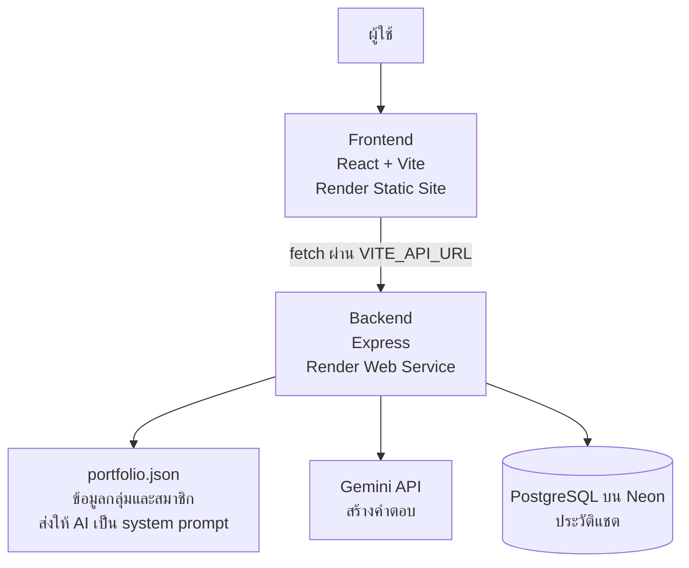

# AIE312-404-Brain-not-found
AI-powered detective-themed team portfolio website built with React, Express.js, PostgreSQL, and Gemini API. AIE312 Final Project.

### เกี่ยวกับโปรเจกต์ (404 Brain Not Found · Chat AI Portfolio)
เว็บแอป Portfolio ของกลุ่ม 404 Brain Not Found (Detective Development Team) ในธีมแฟ้มคดีนักสืบ ผู้เยี่ยมชมดูข้อมูลทีมและสมาชิกแต่ละคน หรือพูดคุยกับ Detective AI ที่ตอบจากข้อมูล Portfolio จริงของสมาชิกทุกคน

## Live demo
| ส่วน | ลิงค์ |
| --- | --- |
| เว็บไซต์ (Frontend) | https://aie312-404-brain-not-found-fe.onrender.com |
| Backend API | https://aie312-404-brain-not-found-be.onrender.com |
| ตรวจสถานะ BE | https://aie312-404-brain-not-found-be.onrender.com/health |

> Render แบบ Free จะหลับเมื่อไม่มีคนใช้งาน การเปิดครั้งแรกอาจรอ 30-60 วินาที ถ้าหน้าแชตค้างตอนแรกให้รอแล้วลองใหม่

## สมาชิก
| ชื่อ-นามสกุล | บทบาท | ความรับผิดชอบ | GitHub |
| --- | --- | --- | --- |
| Teernai Teeraparpvongsa (Tonn) | Backend Developer | Express API, ฐานข้อมูล PostgreSQL บน Neon, เชื่อม Gemini และเขียน system prompt, CI/CD, deploy | teeranai-teer |
| Suppakorn Sangjan (Peem) | Frontend Developer | ออกแบบและพัฒนาหน้าเว็บด้วย React, ห้องแชต, รองรับมือถือ, เชื่อมกับ Backend | Peem040 |

## ฟีเจอร์
- Portfolio: หน้าแรก, ทีมและสมาชิก, หน้าโปรไฟล์รายคน (ประวัติ ทักษะ ผลงาน ช่องทางติดต่อ), โปรเจกต์ทั้งหมด, ติดต่อ
- Chat AI (Interrogation Room): ถามเรื่องกลุ่มและสมาชิก AI ตอบจากข้อมูลใน portfolio.json เท่านั้น ถ้าไม่มีข้อมูลจะบอกตรงๆ ไม่แต่งเรื่อง และจำบริบทการสนทนาล่าสุด
- ประวัติแชต: เก็บในฐานข้อมูล PostgreSQL ผูกกับ sessionId ของแต่ละเบราว์เซอร์ รีเฟรชแล้วประวัติยังอยู่
- ตั้งค่า: สลับธีม 3 แบบ และสลับภาษาไทย/อังกฤษ
- รองรับมือถือ
- CI/CD: push เข้า main แล้วระบบทดสอบและ deploy ให้อัตโนมัติ

## Tech Stack
| ส่วน | เทคโนโลยี/เครื่องมือที่ใช้ |
| --- | --- |
| Frontend | React, Vite, React Router |
| Backend | Node.js, Express |
| Database | PostgreSQL บน Neon |
| AI | Google Gemini API (@google/genai) โมเดลตั้งผ่าน GEMINI_MODEL |
| CI/CD | GitHub Actions |
| Hosting | Render (Web Service สำหรับ BE, Static Site สำหรับ FE) |

## สถาปัตยกรรม

ลำดับการทำงานของแชต: FE ส่ง { sessionId, message } ไป POST /api/chat → BE ดึงประวัติล่าสุดของ session จาก DB → ส่งข้อมูล Portfolio + ประวัติ + คำถามให้ Gemini → บันทึกคำถามและคำตอบลง DB → ส่ง { reply } กลับ

